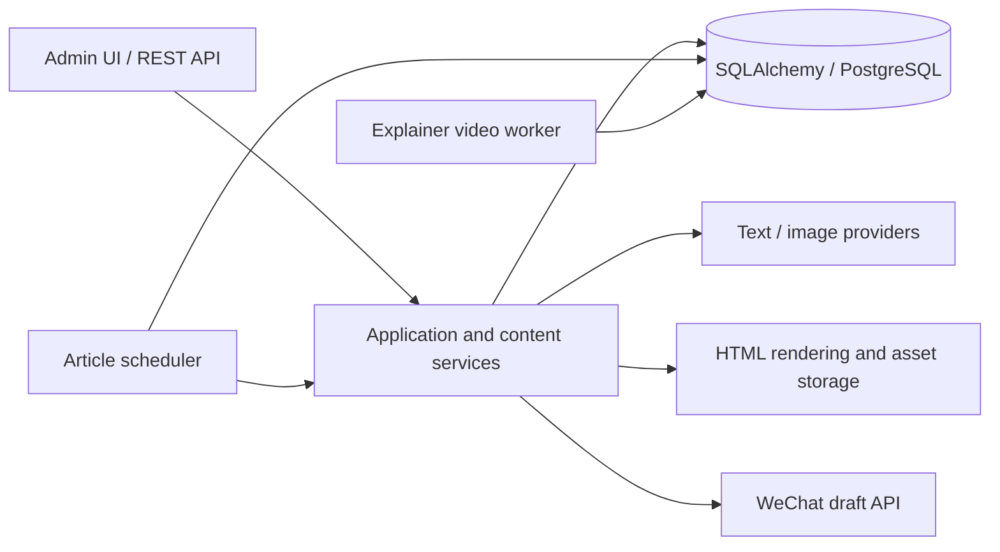

# WeChat Content Generator

**English** | [简体中文](README.zh-CN.md)

A modular Python application for producing content for WeChat Official Accounts. It brings topic selection, structured writing, Chinese-language editing, illustrations, HTML rendering, scheduled jobs, and draft publishing into a persistent, recoverable pipeline.

Maintained independently in `David-the-happy-piglet/wechat-cg`, with `main` as the default branch. The separate AI drama production platform lives in [AI-drama-studio](https://github.com/David-the-happy-piglet/AI-drama-studio).

## Engineering structure

```text
.
├── wechat-content-service/
│   ├── app/
│   │   ├── main.py                 # FastAPI entry point, lifecycle and health checks
│   │   ├── api.py / admin.py       # JSON API and Jinja admin interface
│   │   ├── application/            # Application use cases and coordination
│   │   ├── models.py / schemas.py  # SQLAlchemy entities and request/response contracts
│   │   ├── repositories.py        # Data access and built-in audience initialization
│   │   ├── content_workflows.py   # Content types and workflow metadata
│   │   ├── services/              # Writing, editing, images, rendering and publishing
│   │   ├── scheduler.py           # Separate article scheduling process
│   │   ├── video_api.py           # Article-to-explainer-video API
│   │   └── video_worker.py        # Separate explainer video worker
│   ├── migrations/                # Versioned Alembic database migrations
│   ├── prompts/                   # Maintainable writing prompts
│   ├── templates/                 # Admin UI and WeChat HTML templates
│   ├── media/                     # Video intro/outro assets
│   ├── scripts/                   # Comparison, migration and generation tools
│   └── tests/                     # API, service, recovery and migration tests
├── .github/workflows/ci.yml
├── .env.example                   # Configuration template without credentials
└── docker-compose.yml             # PostgreSQL, API, migrations and workers
```

### Runtime boundaries



The web application, article scheduler, and video worker run as separate processes and share a database and generated asset directory. Compose runs migrations before starting the API and workers. Container deployments use PostgreSQL; local development can use SQLite. Redis and MinIO are reserved behind the optional `reserved-infra` profile and are not required for the current job execution path.

### Design decisions

- **Separate HTTP, orchestration, and integrations.** Routes handle HTTP, the application layer coordinates use cases, services encapsulate writing, images, WeChat, and video capabilities, and models and repositories persist state.
- **Workflows follow content types.** Health articles, relationship articles, and short horror fiction use their own topic selection and prompts. Audience profiles control style and length.
- **Resume after failures.** Automated jobs save text before images. Image retries reuse the existing text, and draft upload retries reuse the existing article.
- **Keep editorial review explicit.** The manual fiction workspace supports handoffs to an external Claude conversation and requires approval before sending a draft. Operators confirm final publication in WeChat.
- **Validate contracts and runtime state.** Pydantic schemas, Alembic migrations, `/livez`, `/readyz`, and dedicated tests cover the main boundaries.

Article-to-explainer-video features share models and the admin interface with the publishing service and remain in this project. The independent React drama studio is maintained in the AI-drama-studio repository.

## Quick start

```bash
git clone https://github.com/David-the-happy-piglet/wechat-cg.git
cd wechat-cg
cp .env.example .env
docker compose up --build
```

Open the [admin interface](http://localhost:8000/admin), [API documentation](http://localhost:8000/docs), or [readiness endpoint](http://localhost:8000/readyz). Defaults use mock text generation and placeholder images, with WeChat integration disabled, so you can inspect the main flow without external credentials.

For real generation, configure text and image providers in `.env`. WeChat account settings use `WECHAT_*`; the relationship-content account uses separate `WECHAT_EMOTIONAL_*` settings. See [.env.example](.env.example) for configuration names. Keep credentials on the server and out of Git.

## Local development and validation

From the repository root:

```bash
python3 -m venv .venv
source .venv/bin/activate
pip install -r wechat-content-service/requirements-dev.txt
cd wechat-content-service
alembic upgrade head
uvicorn app.main:app --env-file ../.env --reload
```

In another terminal, activate the same virtual environment, enter `wechat-content-service`, and run `python -m app.scheduler`. For explainer videos, also run `python -m app.video_worker` in a separate terminal.

Run checks from `wechat-content-service`:

```bash
python -m pytest
python -m ruff check app tests migrations
```

Read the [migration guide](wechat-content-service/migrations/README.md) before upgrading an existing database. CI runs tests, migration checks, and Compose configuration validation with temporary databases, without connecting to a developer's local database.

## Data and credentials

Database files and WAL/SHM sidecars, environment credentials, backups, generated assets, and exports are excluded from version control. The repository contains code, migrations, example configuration, and required static assets. Cloning does not include local application data.

## Project origins

This project was split from the `wechat-cg` branch of `Ctwqk/ContentGenerator`. Original Git history and commit authors are preserved; ongoing development is maintained independently here.
