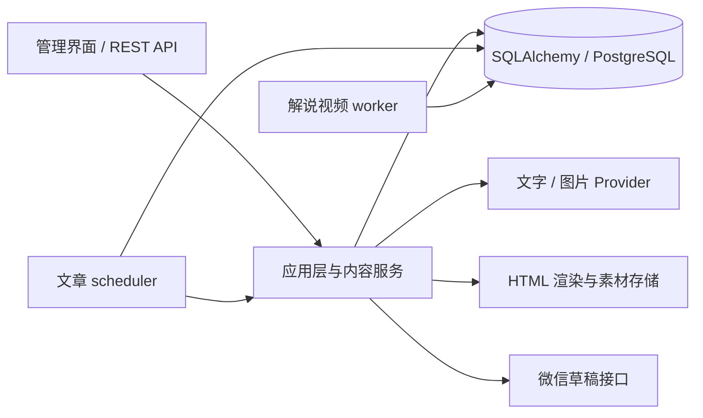

# WeChat Content Generator

面向微信公众号内容生产的 Python 模块化单体应用。把选题、结构化写作、中文润色、配图、HTML 排版、定时任务与微信草稿发布组织为可持久化、可恢复的工程链路。

独立仓库：`David-the-happy-piglet/wechat-cg`，默认分支为 `main`。独立短剧制作平台见 [AI-drama-studio 仓库](https://github.com/David-the-happy-piglet/AI-drama-studio)。

## 工程结构

```text
.
├── wechat-content-service/
│   ├── app/
│   │   ├── main.py                 # FastAPI 入口、生命周期、健康检查
│   │   ├── api.py / admin.py       # JSON API 与 Jinja 管理界面
│   │   ├── application/            # 应用层用例与协调逻辑
│   │   ├── models.py / schemas.py  # SQLAlchemy 实体与请求/响应契约
│   │   ├── repositories.py        # 数据访问、内置受众初始化
│   │   ├── content_workflows.py   # 内容类型与工作流元数据
│   │   ├── services/              # 写作、润色、配图、渲染与发布
│   │   ├── scheduler.py           # 独立文章调度进程
│   │   ├── video_api.py           # 文章解说视频 API
│   │   └── video_worker.py        # 独立解说视频 worker
│   ├── migrations/                # Alembic 版本化数据库迁移
│   ├── prompts/                   # 可维护的写作提示词
│   ├── templates/                 # 管理端和公众号 HTML 模板
│   ├── media/                     # 解说视频片头/片尾资源
│   ├── scripts/                   # 对比实验、迁移与生成工具
│   └── tests/                     # API、服务、恢复与迁移测试
├── .github/workflows/ci.yml
├── .env.example                   # 无密钥配置模板
└── docker-compose.yml             # PostgreSQL、API、迁移与 workers
```

### 运行边界



Web、文章调度器和视频 worker 是独立进程，共享数据库和生成素材目录。Compose 在 API/worker 启动前执行迁移；生产路径使用 PostgreSQL，本地开发可使用 SQLite。Redis、MinIO 仅作为 `reserved-infra` profile 预留，并非当前任务执行的必要依赖。

### 核心设计

- **业务与接入分层**：路由处理 HTTP，应用层协调用例，服务层封装写作、图片、微信和视频能力，模型与仓储持久化状态。
- **按内容类型组织流程**：健康文章、情感文章、微恐小说使用各自的选题与提示词；受众画像控制风格与篇幅。
- **失败后续跑**：自动任务先保存正文，再保存图片；补图重试复用已有正文，草稿上传重试复用已有文章。
- **人工审阅**：微恐手动工作台支持外部 Claude 写作交接，正文审核通过后才可推送；微信正式发布仍由运营者确认。
- **接口与运行检查**：Pydantic 契约、Alembic 迁移、`/livez`、`/readyz` 和独立测试覆盖主要边界。

文章转解说视频与公众号服务共用模型和管理界面，因此保留在本分支；独立的 React 短剧平台在 AI-drama-studio 仓库维护。

## 快速运行

```bash
git clone https://github.com/David-the-happy-piglet/wechat-cg.git
cd wechat-cg
cp .env.example .env
docker compose up --build
```

打开 [管理界面](http://localhost:8000/admin)、[API 文档](http://localhost:8000/docs) 或 [就绪检查](http://localhost:8000/readyz)。默认文本生成使用 mock、图片使用占位图，微信接口关闭，无需外部密钥即可检查主流程。

真实生成请在 `.env` 中配置相应文字与图片 provider；微信账号配置使用 `WECHAT_*`，情感号使用独立的 `WECHAT_EMOTIONAL_*`。所有配置名见 [.env.example](.env.example)。密钥只放在服务端，不提交 Git。

## 本地开发与验证

```bash
python3 -m venv .venv
source .venv/bin/activate
pip install -r wechat-content-service/requirements-dev.txt
cd wechat-content-service
alembic upgrade head
uvicorn app.main:app --env-file ../.env --reload
```

另开终端，在相同虚拟环境和目录运行 `python -m app.scheduler`；使用解说视频时再运行 `python -m app.video_worker`。

```bash
python -m pytest
python -m ruff check app tests migrations
```

已有数据库升级前请阅读 [迁移说明](wechat-content-service/migrations/README.md)。CI 使用临时数据库执行测试、迁移检查和 Compose 配置检查，不连接开发者本地数据库。

## 数据与凭据

数据库文件及 WAL/SHM sidecar、环境密钥、备份、生成素材和导出产物均不纳入版本管理。仓库只保存代码、迁移、配置示例和必要的静态资源；本地数据不会随 clone 获取。

## 项目来源

本项目从 `Ctwqk/ContentGenerator` 的 `wechat-cg` 分支拆分，保留原始 Git 历史与提交作者信息。后续在本仓库独立维护。
